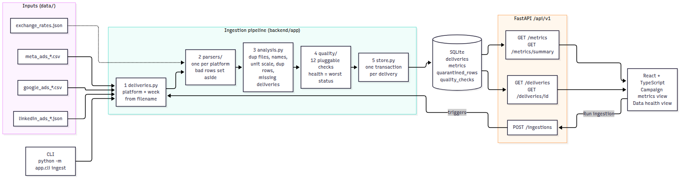

# Campaign Data Hub

Normalizes weekly ad-platform exports (Meta, Google, LinkedIn) into one dataset and assesses the
quality of every delivery, so both the numbers and how far to trust them are visible in one place.

- **Backend:** Python, FastAPI, plain `sqlite3`. **Frontend:** React + TypeScript (Vite).

**Result on the provided data:** 16 deliveries assessed (15 files plus one that never arrived),
**5 fail, 3 warn, 8 pass**. 359 rows loaded, 18 rows set aside. Total spend **$53,509.72**,
16,152,706 impressions, 346,563 clicks.

---

## 1. Quick start

**You need:** Python **3.10 or newer** (tested on 3.10 and 3.12). Nothing else.

### macOS / Linux

```bash
cd backend
python3 -m venv .venv
source .venv/bin/activate
pip install -r requirements.txt
python ../scripts/doctor.py          # optional: checks the setup and says what is missing
uvicorn app.main:app
```

### Windows (PowerShell)

```powershell
cd backend
py -m venv .venv
.venv\Scripts\Activate.ps1           # if blocked:  Set-ExecutionPolicy -Scope Process Bypass
pip install -r requirements.txt
python ..\scripts\doctor.py
uvicorn app.main:app
```

(Windows `cmd`: use `.venv\Scripts\activate.bat`. If `python` is not found, try `py` or `python3`.)

Then open:

| URL | What |
|---|---|
| http://localhost:8000 | The app (metrics view and data health view) |
| http://localhost:8000/docs | Interactive API documentation |

Port 8000 busy? `uvicorn app.main:app --port 8001`.

### Running ingestion

The database starts empty. Load the data any one of these ways (all are safe to repeat):

```bash
# 1. In the UI: click "Run ingestion" (top right)

# 2. CLI (from backend/)
python -m app.cli ingest                      # everything
python -m app.cli ingest --file meta_ads_2026-06-08.csv    # one delivery

# 3. API
curl -X POST http://localhost:8000/api/v1/ingestions
curl -X POST http://localhost:8000/api/v1/ingestions -H "Content-Type: application/json" \
     -d '{"filename": "meta_ads_2026-06-08.csv"}'
```

To see idempotency, run it twice and compare: `GET /api/v1/metrics?limit=1` reports `"total": 359` both times,
and the data-health view is unchanged. To start from scratch, stop the server and delete `backend/campaign_hub.db`.

### Tests

```bash
cd backend
python -m pytest -q          # 22 tests, about 3 seconds
```

### Editing the UI (needs Node 20.19+ or 22.12+)

```bash
cd frontend
npm install
npm run dev                  # http://localhost:5173, with hot reload; /api is proxied to the backend
npm run build                # refreshes frontend/dist, which the backend serves
```

`frontend/dist/` is committed on purpose so the app runs without Node. Rebuild it after UI changes.
If the API is not on port 8000: `VITE_API_PROXY=http://127.0.0.1:8001 npm run dev`.

### Configuration (all optional)

| Variable | Default | Purpose |
|---|---|---|
| `HUB_DB_PATH` | `backend/campaign_hub.db` | SQLite file |
| `HUB_DELIVERIES_DIR` | `data/deliveries` | Folder scanned for delivery files |
| `HUB_RATES_FILE` | `data/exchange_rates.json` | FX rates |
| `HUB_FRONTEND_DIST` | `frontend/dist` | Built UI served at `/` |
| `HUB_CORS_ORIGINS` | `http://localhost:5173,...` | Only matters if the UI is served from another origin |

---

## 2. Architecture



*(Source: [`docs/architecture.mmd`](docs/architecture.mmd), Mermaid.)*

One ingestion run does this:

1. **`deliveries.py`** lists the folder and reads platform and week from each filename. Names it cannot
   interpret become a failed delivery of their own instead of being ignored.
2. **`parsers/`** has one small parser per platform that only *extracts* fields. All validity rules live in
   one function, `parsers/common.py::build_metric`. A bad row is set aside with its reason; it never stops the file.
3. **`analysis.py`** handles everything that needs more than one row or one file in view: identical
   re-deliveries (content hash), unifying campaign names, detecting unit errors against the platform's other
   deliveries, dropping duplicate rows, and creating placeholders for deliveries that never arrived.
   It is a **pure function of the folder**: it reads files and touches no database.
4. **`quality/`** runs 12 independent checks over the result and rolls them up into a health status.
5. **`store.py`** writes each delivery in its own transaction, deleting any earlier copy of it first.

The API reads the same SQLite tables. The UI only ever talks to the API.

---

## 3. Normalization

All platforms end up as one shape: `platform, campaign, date, spend_usd, impressions, clicks`
(plus `delivery_id`, `source_row` and `transforms`, see traceability below).

| | Meta Ads | Google Ads | LinkedIn Ads |
|---|---|---|---|
| Format | CSV | CSV | JSON array |
| Date | `MM/DD/YYYY` | `YYYY-MM-DD` | epoch milliseconds (read as UTC) |
| Spend | `spend_usd`, dollars | `Cost (micros)` divided by 1,000,000 | `spend.amount` (a string), in EUR, times 1.08 |
| Impressions | `impressions` | `Impr.` | `impressions` |

Resulting totals (verified against an independent recomputation straight from the raw files):

| Platform | Rows | Spend (USD) | Impressions | Clicks |
|---|---:|---:|---:|---:|
| Google Ads | 150 | 27,954.50 | 8,561,131 | 187,345 |
| Meta Ads | 145 | 19,685.25 | 5,793,353 | 121,193 |
| LinkedIn Ads | 64 | 5,869.97 | 1,798,222 | 38,025 |
| **All** | **359** | **53,509.72** | **16,152,706** | **346,563** |

Overall CTR 2.15%, CPC $0.154. These exclude the 18 rows set aside (section 4.3) and include the
correction to Meta's 06-08 spend.

---

## 4. Data quality

### 4.1 The 12 checks

All thresholds are in one file, [`backend/app/quality/policy.py`](backend/app/quality/policy.py).

| Check | Level | Detects | Status rule |
|---|---|---|---|
| `filename_recognized` | file | Filename not `<platform>_<week>[_resend].<ext>` | fail |
| `file_readable` | file | Unparseable file (bad JSON, missing columns, binary junk) | fail |
| `delivery_received` | delivery | A platform's weekly delivery never arrived | fail |
| `duplicate_delivery` | delivery | Byte-identical to an earlier delivery of the same platform | fail (not loaded) |
| `completeness` | row | Missing values | none: pass; up to 5% of rows: warn; above: fail |
| `validity` | row | Impossible date, non-numeric or negative values, unknown currency, clicks greater than impressions | same as completeness |
| `duplicate_rows` | row | Exact duplicate rows | warn |
| `conflicting_duplicates` | row | Same campaign and day, different numbers | fail |
| `normalization` | row | Repairs we made: whitespace, capitalization, date format | warn |
| `coverage` | file | Expected campaign-days that arrived with valid data | 100%: pass; 90% or more: warn; below: fail |
| `date_window` | file | Rows dated outside the week the filename promises | up to 5%: warn; above: fail |
| `unit_scale` | file | Spend per 1,000 impressions far from the platform's other deliveries | fail |

**Health of a delivery is the worst status among its checks.** Every check returns a one-line summary
plus structured evidence (counts, example rows, missing cells), which the UI renders generically.

### 4.2 Why these thresholds

- **5% of rows** separates "a few bad rows in an otherwise usable file" from "the export itself is broken".
  It is a judgment call; it lives in `policy.py` so it is a one-line change.
- **Exact duplicate rows only warn**: once removed, no information is lost. **Conflicting** duplicates
  fail, because we cannot know which number is right.
- **`unit_scale` compares CPM, not raw spend**, so a legitimately busy week is not mistaken for a unit error.
  It only auto-corrects when the ratio is within 25% of 100 or 1,000; any other anomaly is flagged `fail`
  and the data is loaded unchanged.

### 4.3 What the checks found in the provided data

| Defect | Delivery | Caught by | What the system does | Health |
|---|---|---|---|---|
| 8 exact duplicate rows (43 rows, 35 expected) | `google_ads_2026-06-01.csv` | `duplicate_rows` | Keeps the first copy, sets 8 aside | warn |
| Same file delivered twice | `google_ads_2026-06-15_resend.csv` | `duplicate_delivery` | Not loaded (would double that week) | fail |
| Whole week never delivered | `linkedin_ads_2026-06-22` | `delivery_received` | Shown as a missing delivery | fail |
| Spend about 100x too large (looks like cents) | `meta_ads_2026-06-08.csv` | `unit_scale` (CPM is 106x the baseline) | Divides all 35 rows by 100 and records it | fail |
| Impossible date `06/31/2026` | `meta_ads_2026-06-01.csv` | `validity` | Row set aside | warn |
| One ISO date in a `MM/DD/YYYY` file | `meta_ads_2026-06-01.csv` | `normalization` | Parsed and flagged | warn |
| 3 lowercase campaign names | `meta_ads_2026-06-01.csv` | `normalization` | Unified to the dominant spelling | warn |
| 3 blank `clicks` (8.6% of rows) | `meta_ads_2026-06-15.csv` | `completeness` | Rows set aside | fail |
| 3 names with trailing spaces | `meta_ads_2026-06-15.csv` | `normalization` | Trimmed | (fail, from above) |
| 1 negative spend | `meta_ads_2026-06-22.csv` | `validity` | Row set aside | warn |
| 5 records missing the `clicks` key (24%) | `linkedin_ads_2026-06-08.json` | `completeness` | Rows set aside | fail |

Rows set aside also lower `coverage` (for example Meta 06-15 has 32 of 35 campaign-days), which is
reported in the same delivery. The other 8 deliveries pass all checks.

### 4.4 What I looked for and did not find

- **Statistical outliers.** All three platforms sit in the same bands (CTR 0.8% to 3.5%, CPM $2.4 to
  $5.5). The day-to-day variation is noise inside those bands, so a z-score check would only flag noise.
  I did not add one (see section 9).
- **Timezone drift in LinkedIn timestamps.** All fall inside their delivery's date window.
- **Zero impressions, zero clicks or zero spend** in the loaded data. The API still handles them (section 6).

---

## 5. Non-functional requirements

**Idempotency.** `analysis.py` is a pure function of the folder, so the same input always produces the same
result. A full run rebuilds the tables from it. A single-delivery run deletes that delivery and rewrites it
(`filename` is unique and `ON DELETE CASCADE` removes its rows). A unique key on
`(platform, campaign, date)` makes duplicate metrics impossible at the database level.
Tested: full and single re-ingestion leave an identical snapshot, including through the API.

**Error isolation.** Three boundaries: `parse_file` never raises (an unreadable file becomes a failed
delivery), each check runs inside a try/except (a crashing check is reported as a failed check), and each
delivery is written in its own transaction. Tested with malformed JSON, wrong columns, binary garbage,
an unrecognized filename and records that are not objects, all in one run.

**Traceability.** Every metric row stores `delivery_id`, `source_row` (CSV line or JSON position) and a
`transforms` list (for example `micros/1e6`, `fx EUR->USD @ 1.08`, `unit_scale: spend / 100 ...`).
`/metrics/summary` returns a `lineage` block for exactly the rows behind the numbers: which deliveries
contributed and which rules touched them. The UI shows it under "Where do these numbers come from?".
Set-aside rows keep their original raw values in `quarantined_rows`.

---

## 6. API

Base path `/api/v1`. Interactive docs at `/docs`.

| Endpoint | Purpose |
|---|---|
| `GET /metrics` | Normalized daily rows. Filters `platform`, `date_from`, `date_to`, `campaign`; paging `limit` (1 to 1000, default 100), `offset` |
| `GET /metrics/summary` | Totals plus CTR and CPC, `group_by=campaign\|platform`, `sort_by`, `order`; includes `lineage` |
| `GET /deliveries` | Every delivery with health, row counts, check counts and its non-passing checks. Filters `health`, `platform` |
| `GET /deliveries/{id}` | Full quality report: every check with evidence, plus the set-aside rows with raw values |
| `POST /ingestions` | Full run, or `{"filename": "..."}` to re-ingest one delivery |

Conventions:

- **Ratios are `null`, never `0` or an error, when the denominator is 0**: CPC with no clicks, CTR with no
  impressions. A CPC of 0 would wrongly read as "free clicks". Nulls sort last in either direction.
- **One error shape everywhere:** `{"error": {"code": "...", "message": "...", "details": [...]}}`.
- **Status codes:** `404 delivery_not_found`, `409 ingestion_in_progress` (a lock allows one run at a time),
  `422 validation_error` / `invalid_date_range`, `500 deliveries_unavailable`.
- Totals, groups and lineage are built from the same filter code, so the summary cannot disagree with the list.

```bash
curl "http://localhost:8000/api/v1/metrics/summary?group_by=platform&date_from=2026-06-08&date_to=2026-06-14"
```

---

## 7. Frontend

React 19 + TypeScript. No router and no state library; the app is small enough that neither pays for itself.

- **Campaign metrics:** table sortable on every column (default spend, descending), filters for platform
  and date range, group by campaign or platform, totals that follow the filters, and the lineage panel.
  Loading, error-with-retry, "no data yet" and "no match" states are distinct. A reversed date range shows an
  inline message instead of sending a bad request.
- **Data health:** a platform-by-week grid colored by status (a missing delivery and an original-plus-resend pair are
  visible at a glance), a worst-first list with each delivery's main finding, and a drill-down with every check's
  evidence and the set-aside rows.
- **Data fetching:** one hook, `hooks/useApi.ts`. It aborts outdated requests so a slow response for old
  filters can never overwrite a newer one, keeps previous data visible while refetching, and drops it on error so
  stale numbers never sit beside an error message.
- Sorting happens on the server so there is one definition of order. A selected delivery is tracked by
  filename, not id, because a full re-ingestion rebuilds the ids.

---

## 8. Design decisions and trade-offs

| Decision | Why | Cost / alternative |
|---|---|---|
| **SQLite via plain `sqlite3`**, no ORM | Zero setup, so a fresh clone runs from this README; every query is visible and easy to change | One writer at a time; no migrations. Postgres is the first thing I would move to (section 9) |
| **Analysis is pure; a full run rebuilds the tables** | Idempotency by construction instead of by careful bookkeeping | Does not scale to large histories; fine at this size |
| **Set aside bad rows rather than guess** | A wrong number silently in the dataset is worse than a missing one that is reported | Spend is slightly under-counted (18 rows). The `06/31` row is probably a corrupted `06/01`, but I do not invent dates |
| **Correct the Meta 06-08 spend by dividing by 100** | The pattern is unambiguous (106x) and discarding the file would drop a whole week of Meta spend | It is a heuristic. Anything not near 100x or 1,000x is flagged but not changed |
| **Duplicate delivery detected by byte hash** | Simple and exact | Same data with different line endings would not match (a row-set comparison would) |
| **First occurrence wins** for duplicate rows | Deterministic, and processing order is chronological with originals before resends | A later restatement of an earlier day is treated as a conflict, not an update |
| **Campaign names unified to the most common spelling per platform** | No reference list to maintain | A campaign that only ever appears misspelled stays misspelled |
| **Expected window = 7 days from the filename date, cut at month end** | Matches the brief (the last delivery covers two days) | A hard-coded assumption about monthly cuts |
| **Spend stored as `REAL`** | Simple | Float sums can differ by around 1e-9; integer micros would be exact |
| **Ingestion is synchronous**, guarded by a lock | Instant at this size, simplest to reason about | A real system would run it as a background job |
| **Prebuilt UI committed** | Runs with Python alone | A build artifact in git; must be rebuilt after UI edits |

Assumptions worth stating: LinkedIn epoch timestamps are UTC; one delivery per platform per week from the first
to the last week seen; FX rates are fixed, as supplied by finance.

---

## 9. What I would do with more time

In rough priority order.

**Trust in the numbers**
1. **Review and recovery workflow for set-aside rows.** Today they are reported but only a person can fix them.
   Add manual correction with an audit trail (for example mark `06/31` as `06/01`) and re-ingest.
2. **Anomaly detection with real baselines.** Per-campaign rolling or seasonal baselines for spend and volume,
   and week-over-week change. I skipped it because this data is uniform noise (section 4.4); real data would not be.
3. **Semantic duplicate detection.** Compare the set of rows, not bytes, and handle legitimate **restatements**
   (a later delivery correcting an earlier one) with versioning instead of "first wins".
4. **Exact money.** Store integer micros (or decimals) end to end.
5. **Schema drift detection.** Alert on new, renamed or missing columns instead of failing the whole file.

**Operability**
6. **Background ingestion with run history.** An `ingestion_runs` table, status polling, and an audit trail of what each
   run changed. Replace the single in-process lock.
7. **Incremental ingestion** (only new or changed files) and a landing folder or object-store watcher.
8. **Postgres and `docker-compose.yml`.** The storage layer is isolated in `db.py` and `store.py`, so this is
   contained work, plus migrations (Alembic).
9. **Structured logging, metrics and alerting** when a delivery fails or goes missing, which is the real
   business problem the brief describes.

**Product and engineering hygiene**
10. **Frontend tests committed to the repo.** I verified the UI with scripted browser runs during development but
    those scripts are not in the repo. Add Playwright end-to-end tests plus component tests, then CI.
11. **CI matrix:** pytest on Python 3.10 to 3.13 across Linux, macOS and Windows; frontend lint, type-check and build.
12. **Charts** (spend over time), filters kept in the URL, pagination for deliveries, auth, and an accessibility audit.
13. **Config-driven platform mappings** (a YAML schema per platform) so adding a platform needs no code, and dated FX rates.

---

## 10. Where to change what

| I want to... | Go to |
|---|---|
| Add a quality check | Subclass `Check` in `backend/app/quality/checks.py` (or add a `RowIssueCheck(...)` line), then append it to `CHECKS` in `quality/__init__.py`. The UI shows it with no changes |
| Change a threshold | `backend/app/quality/policy.py` |
| Add or change a row-level validation rule | `backend/app/parsers/common.py`, function `build_metric` |
| Add a platform | New module in `backend/app/parsers/`, register it in `parsers/__init__.py`, add it to `config.PLATFORMS` and the filename pattern in `deliveries.py`, and add its label in `frontend/src/lib/format.ts` |
| Add a currency | `data/exchange_rates.json` |
| Change which unit errors are auto-corrected | `SCALE_FACTORS` in `policy.py` |
| Add a derived metric | `derive()` in `backend/app/routes/metrics.py`, `Derived` in `schemas.py`, then the columns in `frontend/src/views/metrics/MetricsTable.tsx` |
| Add an API filter | `Filters` in `backend/app/deps.py` (list and summary share it) |
| Change how health is rolled up | `health_from` in `backend/app/quality/__init__.py` |

---

## 11. Tests

22 tests, run on Python 3.10 and 3.12.

| Area | What is proven |
|---|---|
| Idempotency | A full re-run and a single-delivery re-run leave identical tables (rows, results, set-aside rows) |
| Planted defects | Health of all 16 deliveries and the specific check that fires for each defect |
| Numbers | The resend is not double counted; Google micros, EUR conversion and the Meta rescale give the expected values; names are unified |
| Error isolation | Malformed JSON, wrong columns, binary junk, an unrecognized filename and non-object records do not abort the run; a crashing check is reported, not raised |
| Portability | Files with Windows line endings and an Excel BOM give identical results |
| API | Filters and paging; totals match the groups and follow filters; sort order; null CPC and CTR with nulls last; lineage; error bodies and status codes; idempotent POST; 404 and 409; UI served without hiding the API |

## 12. Repository layout

```
README.md
docs/                  architecture diagram (png + mermaid source) and the assessment brief
data/                  deliveries/ and exchange_rates.json (as provided)
backend/
  app/
    config.py db.py models.py        settings, SQLite schema, shared dataclasses
    deliveries.py                    filename discovery, expected date window
    parsers/                         meta, google, linkedin + common.py (all row validation)
    analysis.py                      cross-file analysis (pure)
    quality/                         checks, policy (thresholds), runner and health roll-up
    store.py pipeline.py cli.py      persistence and orchestration
    main.py routes/ deps.py errors.py schemas.py   the API
  tests/  requirements.txt  pytest.ini
frontend/                src/ (api, hooks, lib, components, views), dist/ (prebuilt), package.json
scripts/                 doctor.py (setup check), parse_smoke.py (parser dry run, no database)
```
